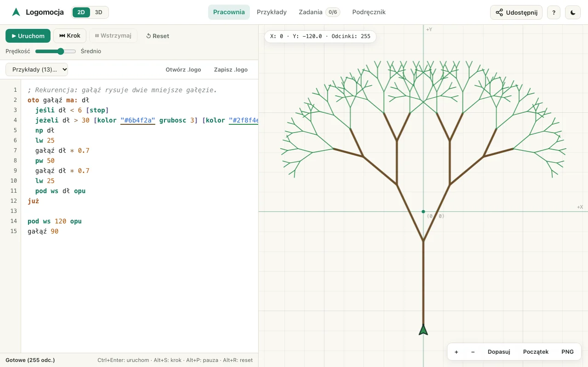
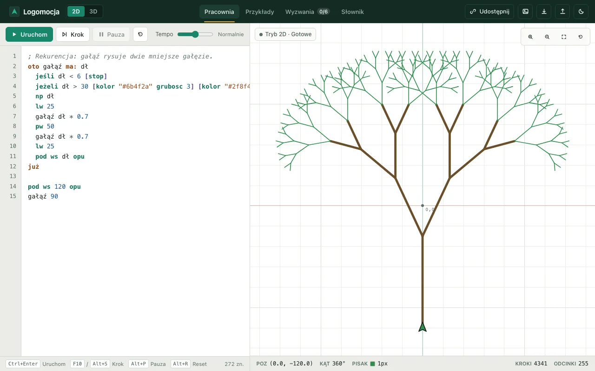
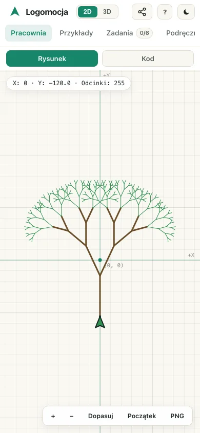
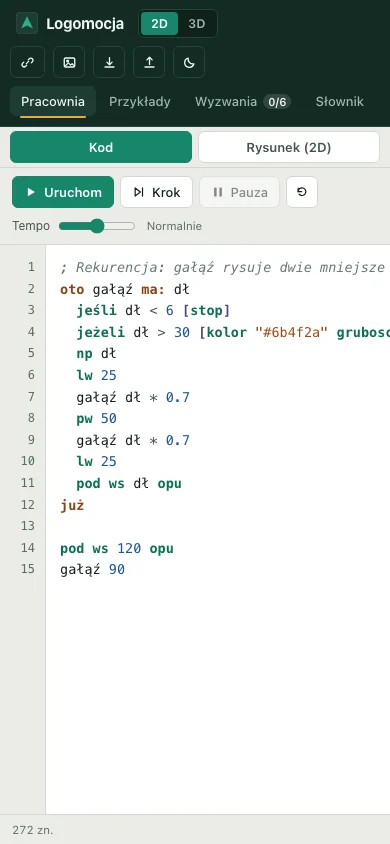
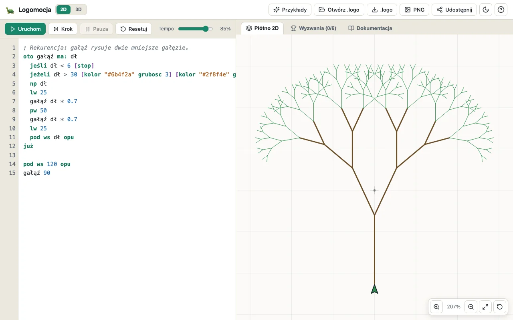
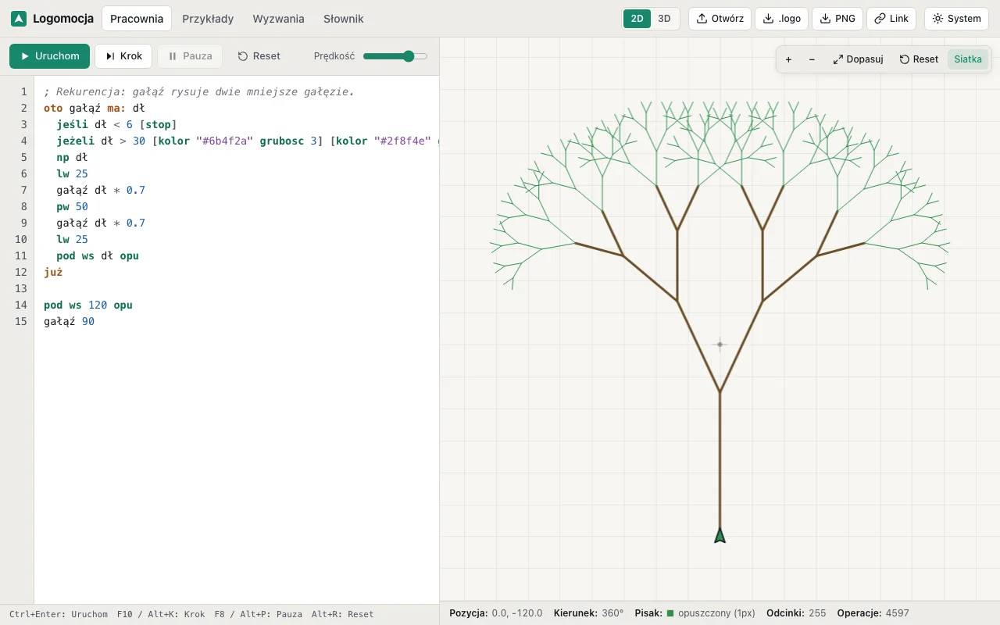
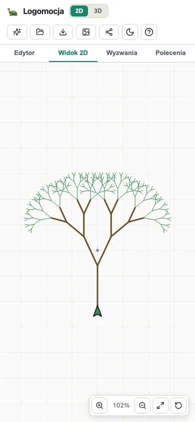
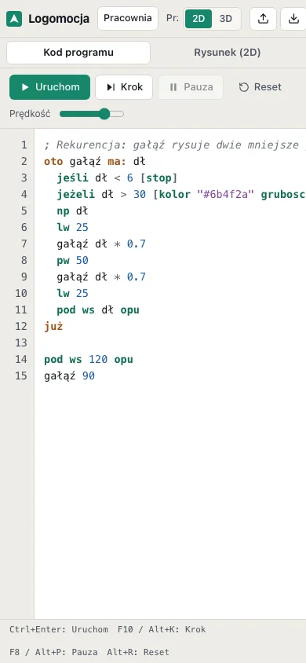

# Gemini 4 Neon and Hydrogen · Medium

Four scored Logomocja app runs on 19 November 2026 used the frozen v2 task. Both models ran once with the base brief and once with Impeccable 4.7.0 and engine 0.1.16.

| Model | Condition | Generation time | Interpreter | Editor | Standard drawings | Generated tests |
| --- | --- | ---: | ---: | ---: | ---: | ---: |
| Gemini 4 Neon | Base | 13m 10s | 618/618 | 618/618 | 13/13 | 47 passed |
| Gemini 4 Neon | Impeccable | 16m 51s | 618/618 | 618/618 | 13/13 | 45 passed |
| Gemini 4 Hydrogen | Base | 6m 56s | 601/618 | 601/618 | 13/13 | 34 passed |
| Gemini 4 Hydrogen | Impeccable | 8m 55s | 602/618 | 602/618 | 13/13 | 34 passed |

All four apps installed and built. Each score includes 595 language cases and 23 stress cases. Every app passed the stress cases through both paths.

The [benchmark explorer](https://yis-company.github.io/Logomocja/) links to playable
copies rebuilt from the archived sources in env-7 with Bun 1.4.4 and Node 26.13.1.
The rebuilds use the archived lockfiles where the app has dependencies, with a
Pages base path for each run. The scores and screenshots come from the original
verification.

The Impeccable runs took 28.0% longer for Neon and 28.5% longer for Hydrogen. Neon stayed at full conformance. Hydrogen passed 13 cases it previously missed and missed 12 cases it previously passed. In the layered Hydrogen build, 13 failures report an incorrect error column, one reports an unexpected variable error, and two empty-repeat cases throw a `TypeError`.

## Screenshots

The desktop and base mobile captures show the standard 2D tree. The Impeccable
mobile captures show the editor with the drawing out of view.

| Model and viewport | Base | Impeccable |
| --- | --- | --- |
| Neon desktop |  |  |
| Neon mobile |  |  |
| Hydrogen desktop |  |  |
| Hydrogen mobile |  |  |

## Method and limits

- The Antigravity CLI generated each app in a fresh workspace on macOS arm64. Engineering verification ran in the existing environment 7 Docker image with Bun 1.4.4 and Node 26.13.1. The repository's Playwright 1.65.1 and Chromium 159.0.8154.6 ran the v2 conformance and gallery checks. Keep the pilot timings separate from the Docker leaderboard.
- The base runs used CLI 1.5.0. The Impeccable runs used 1.5.12. CLI drift and one attempt per condition limit causal attribution. Gallery checks compare drawing output. Visual quality, pricing, and quota consumption were unmeasured.
- Three setup attempts hit Antigravity sandbox permissions before scoring. The ledger records the specific boundaries. The corrected runs used isolated caches and workspace-local scratch paths. The four scored attempts completed without reported quota or permission errors.
- Source archives preserve the generated files and omit macOS filesystem metadata. Browser failures retain their diagnostics with localhost ports normalized.

## Run evidence

| Run | Source | Checks | Screenshots |
| --- | --- | --- | --- |
| Neon base | [Source archive](neon-base/source.tar.gz) | [Build and tests](neon-base/verify.log) · [Conformance](neon-base/conformance.json) | [Gallery](neon-base/gallery/) |
| Neon Impeccable | [Source archive](neon-impeccable/source.tar.gz) | [Build and tests](neon-impeccable/verify.log) · [Conformance](neon-impeccable/conformance.json) | [Gallery](neon-impeccable/gallery/) |
| Hydrogen base | [Source archive](hydrogen-base/source.tar.gz) | [Build and tests](hydrogen-base/verify.log) · [Conformance](hydrogen-base/conformance.json) | [Gallery](hydrogen-base/gallery/) |
| Hydrogen Impeccable | [Source archive](hydrogen-impeccable/source.tar.gz) | [Build and tests](hydrogen-impeccable/verify.log) · [Conformance](hydrogen-impeccable/conformance.json) | [Gallery](hydrogen-impeccable/gallery/) |

[Exact metrics and seven-attempt ledger](comparison.json) · [Base prompt](prompt-base.md) · [Impeccable prompt](prompt-impeccable.md) · [Initial Impeccable prompt](prompt-impeccable-initial.md) · [Skill manifest](layer.json)
